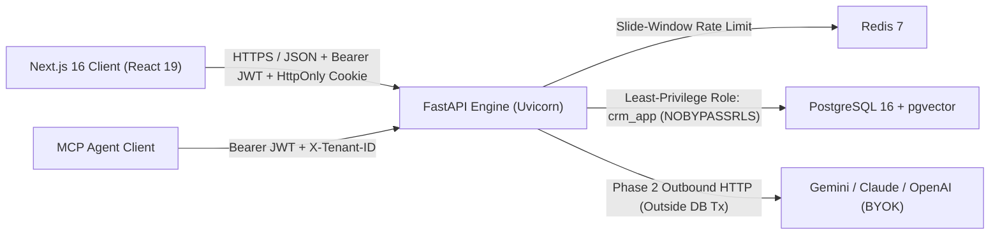
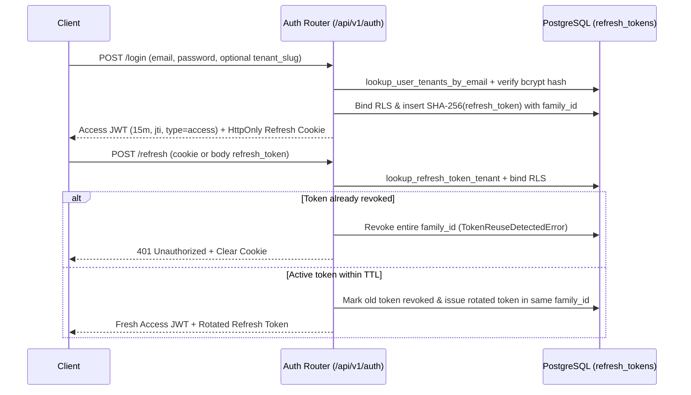

# Architecture Specification

This document describes the runtime topology, tenant isolation model, cryptographic key handling, and AI execution boundaries implemented in Enterprise CRM.

## 1. System Topology



## 2. Multi-Tenant Isolation (Shared Database with Forced RLS)

### Threat Model & Defense in Depth

1. **Application Layer Binding (`get_tenant_db`)**:
   Every tenant-protected request decodes the Bearer access token (`sub`, `tenant_id`, `role`), validates the optional `X-Tenant-ID` header against the JWT claim, verifies inside Postgres that both the `User` and `Tenant` remain `is_active = true`, and invokes `set_tenant_rls_context(session, tenant_id)`.
2. **Transaction-Local GUC Binding**:
   `set_tenant_rls_context` executes `SELECT set_config('app.current_tenant_id', :tenant_id, true)` parameterized via `asyncpg`. Using `is_local = true` scopes the binding strictly to the active transaction and prevents tenant bleed across pooled SQLAlchemy connections.
3. **Database Policy Enforcement**:
   All 14 tenant-owned tables (`users`, `refresh_tokens`, `accounts`, `contacts`, `pipelines`, `pipeline_stages`, `deals`, `interactions`, `tasks`, `lead_embeddings`, `outbox_events`, `ai_proposals`, `ai_audit_logs`, `tenant_llm_credentials`) enable `ENABLE ROW LEVEL SECURITY` and `FORCE ROW LEVEL SECURITY` with dual predicates:
   ```sql
   USING (tenant_id = get_current_tenant_id())
   WITH CHECK (tenant_id = get_current_tenant_id())
   ```
   Runtime queries execute under `crm_app` (`NOSUPERUSER NOCREATEDB NOCREATEROLE NOBYPASSRLS`), while migrations run separately via `MIGRATION_DATABASE_URL` (`crm_user`).
4. **Controlled Pre-Auth Bootstrap (`SECURITY DEFINER`)**:
   Before a user presents a JWT (during email+password login or cookie-based token refresh), PostgreSQL cannot resolve `app.current_tenant_id` directly. Narrow `SECURITY DEFINER` helper functions (`lookup_user_tenants_by_email(VARCHAR)` and `lookup_refresh_token_tenant(VARCHAR)` pinned with `SET search_path = public`) return only the minimal metadata required to bind the subsequent tenant transaction.

## 3. Authentication, Refresh Rotation & Reuse Detection



## 4. Zero-I/O AI Pipeline & Human-in-the-Loop (HITL) Governance

Holding a PostgreSQL transaction open across an external LLM HTTP call starves connection pools and risks holding row locks during upstream timeouts. The Copilot router (`backend/src/api/v1/ai_copilot.py`) strictly isolates database work from network I/O across three phases:

1. **Phase 1 (Short Read Session)**: Verify RBAC, fetch contact/deal context and encrypted BYOK ciphertext, decrypt AES-256-GCM key with `associated_data=str(tenant_id).encode()`, commit/close session.
2. **Phase 2 (Zero DB Locks Held)**: Strip prompt-injection delimiters (`xml_tags` case-insensitive + HTML escaping), call the configured LLM provider via `httpx` with strict Pydantic v2 JSON validation (`LLMAnalysisOutput`). If live inference fails, return structured error `502` rather than fabricating synthetic stub responses (`_call_provider_STUB` only runs in explicit non-production `ALLOW_OFFLINE_AI_STUB=true` testing/development modes when no live key exists).
3. **Phase 3 (Short Write Session)**: Persist redacted `Interaction`, log telemetry + SHA-256 prompt digest in `ai_audit_logs`, and queue suggested mutations (`create_task`, `move_deal_stage`, etc.) as `pending_review` rows in `ai_proposals`.

### Proposal Approval & Real Execution

Approving a proposal via `POST /api/v1/ai/proposals/{proposal_id}/approve` inside `ai_copilot.py` transitions status atomically and executes side effects in PostgreSQL:
- `create_task`: Inserts a real tenant-scoped `Task` assigned to the deal/contact owner.
- `move_deal_stage`: Moves the target `Deal` using stage probability/won/lost rules (recording `loss_reason` if closed lost).
- Rejection records reviewer identity, timestamp, and `rejection_reason` without mutating CRM state.

## 5. Semantic Search (`pgvector`) & Transactional Outbox

- **Vector Search**: Contact/account summaries are indexed into `lead_embeddings` (`vector(768)`) with an HNSW index (`vector_cosine_ops`, `m=16`, `ef_construction=64`). Runtime queries use parameterized cosine distance (`embedding <=> CAST(:qvec AS vector)`) gated by tenant RLS. Hermetic SQLite tests fall back cleanly to Python cosine similarity over JSON vectors.
- **Transactional Outbox**: CRM mutations insert domain events inside the same database transaction as state updates. `outbox_service.py` claims pending rows in bounded batches using `FOR UPDATE SKIP LOCKED` on PostgreSQL and increments `retry_count` / marks `failed` after `max_retries`.

## 6. Security Controls Summary

| Control | Implementation |
| :--- | :--- |
| Password Hashing | Direct `bcrypt` executed via `asyncio.to_thread` |
| BYOK Secret Encryption | AES-256-GCM (`cryptography.hazmat`) with random 96-bit nonce and `tenant_id` AAD |
| Production Secret Guard | `Settings.validate_production_hardening()` rejects default keys, short secrets (<32 bytes), wildcard CORS (`*`), and `ALLOW_OFFLINE_AI_STUB=True` in `staging`/`production` |
| Constant-Time Token Checks | `hmac.compare_digest` via `constant_time_equals` |
| Rate Limiting | Redis Lua/pipeline sliding window with thread-safe local fallback |
| HTTP Security Headers | `X-Correlation-ID`, `X-Content-Type-Options: nosniff`, `X-Frame-Options: DENY`, strict `Content-Security-Policy`, `Referrer-Policy`, `Strict-Transport-Security`, `Permissions-Policy` |
| Containers | Multi-stage Dockerfiles running under non-root UID `10001` (`appuser` / `nextjs`) |
